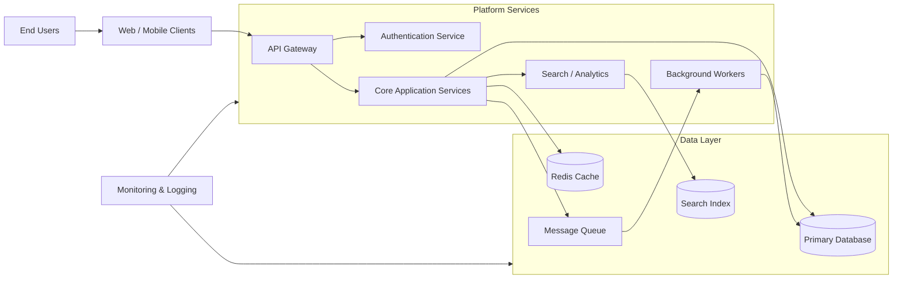

# Architecture Overview

This diagram provides a high-level view of a typical modern application architecture:

- Clients access the platform through an API gateway.
- Authentication and core services handle business logic.
- A relational database stores persistent data.
- Redis provides caching for fast reads.
- A message queue decouples background processing from request handling.
- Search and analytics systems support indexing and retrieval.
- Monitoring collects telemetry from all layers.
